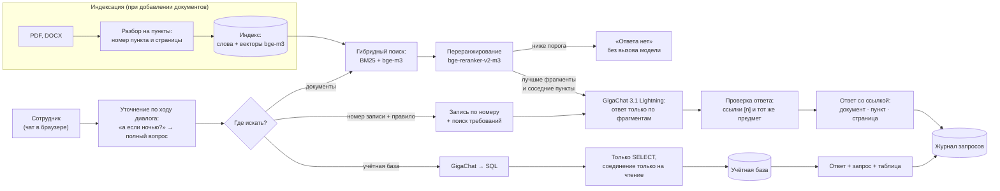

# AI-агент для поиска ответов по внутренней документации и базам данных предприятия

Прототип по задаче индустриального партнёра № 28 (ООО «НПВП «НаноТехноПром») в акселерационной программе «Школа студенческого технологического предпринимательства «Мой стартап» РГРТУ.

Сотрудник задаёт вопрос обычным языком. Агент отвечает **только по внутренним документам и учётной базе**:

- **у каждого ответа есть ссылка** на документ, пункт и страницу; одним кликом открывается страница оригинала, где фрагмент выделен маркером;
- **если ответа нет, агент так и говорит** и подсказывает, где ещё поискать, — не выдумывает;
- **документы и база данных в одном окне:** агент сам решает, где искать, а на вопрос вида «СИ-0012 просрочен — можно ли им работать?» отвечает сразу из обоих источников: запись учёта и требование регламента. К базе обращается только на чтение и показывает запрос;
- **понимает диалог:** уточнение «а если ночью?» дополняется темой предыдущего вопроса, на слишком общий вопрос агент задаёт встречный с вариантами;
- **поправляет неверную посылку** («почему наряд можно продлевать сколько угодно раз?» → «Нет, только один раз [1]») и всегда приводит запреты из процитированного пункта;
- **работает целиком на компьютере предприятия без интернета** на отечественной открытой модели GigaChat 3.1 Lightning (Сбер, лицензия MIT, обучена без иностранных базовых весов);
- **вход по логину и паролю, права по ролям**, журнал запросов и оценки ответов 👍/👎 — у администратора;
- **свой документ подключается прямо в чате** (администратором): PDF, DOCX и сканы с распознаванием текста; можно отметить, что это новая редакция — старая перестанет участвовать в поиске;
- **качество измеряется** на эталонном наборе вопросов, а не обещается.

## Результаты

Эталонный набор `eval/questions.yaml` — 62 вопроса: 40 с ответом в документах, 10 без ответа в документах (в том числе «трудные» — по теме, но отсутствующие в корпусе), 8 к учётной базе, 3 — сразу к записи учёта и регламенту, 1 слишком общий. Кроме основных вопросов в наборе есть перефразировки, опечатки и разговорный ввод, а также группа «ловушки» — 10 вопросов из критического разбора прототипа: уточнения в диалоге, неверная посылка, отменённая редакция документа, вопрос «запись + правило». Полная таблица — `eval/results/latest.md`.

| Метрика | Значение |
|---|---|
| Правильные ответы (верные факты и ссылка на верный пункт) | **40 из 40** |
| Неверные ответы, показанные пользователю | **0 из 40** |
| Честные отказы на вопросы, ответа на которые в документах нет | **10 из 10** |
| Ответы по учётной базе | **8 из 8** |
| Ответы по учётной базе и документам вместе | **3 из 3** |
| Встречный вопрос на слишком общий вопрос | **1 из 1** |
| Время ответа, медиана (RTX 5070) | **1,2 с** |

| Группа вопросов | Верные ответы | Верные отказы | Учётная база | База + документы, уточнения |
|---|---|---|---|---|
| Основной набор | 16 из 16 | 4 из 4 | 5 из 5 | — |
| Новые факты | 10 из 10 | 4 из 4 | 3 из 3 | — |
| Перефразировки | 5 из 5 | — | — | — |
| Опечатки и разговорный ввод | 5 из 5 | — | — | — |
| Ловушки | 4 из 4 | 2 из 2 | — | 4 из 4 |

**Как честно читать эти цифры.** Набор составлен командой и использовался для отладки: на нём найдены и исправлены ошибки — подмена предмета, пропуск запретов, выбор источника, разметка описания базы. Примеры в подсказках модели не совпадают с вопросами набора. Независимую оценку дадут «слепой» набор, который пишут участники, не занимавшиеся отладкой (`eval/blind_template.yaml`), и реальные вопросы сотрудников партнёра. Вызовы модели идут без кэша подсказок, поэтому одинаковый вопрос получает одинаковый ответ; два последних прогона подряд (`latest.md`, `povtor.md`) дали одинаковый результат.

Скорость (`scripts/bench_speed.py`, результаты в `eval/results/speed_*.md`):

| Компьютер | Генерация | Ответ на вопрос (медиана) |
|---|---|---|
| ПК с RTX 5070 12 ГБ | 278 токенов/с | 1,3 с |
| Тот же ПК, только процессор (Ryzen, 12 потоков), с кэшем подсказок (`KB_DETERMINISTIC=0`) | 20 токенов/с | 7,2 с |
| То же, без кэша подсказок (режим по умолчанию) | 20 токенов/с | 9,8 с |

По умолчанию модель вызывается без кэша подсказок: так одинаковый вопрос всегда получает одинаковый ответ (llama.cpp при повторном использовании кэша может давать немного разные ответы). На видеокарте это стоит около 0,3 с, на процессоре — 2–3 с, поэтому без видеокарты рекомендуем `set KB_DETERMINISTIC=0`.

Масштаб (`scripts/bench_scale.py`, `eval/results/scale.md`): на корпусе из 100 тысяч фрагментов (около тысячи документов такого же объёма, как в прототипе) поиск по словам занимает 19 мс, по смыслу — 14 мс, векторы — 391 МБ памяти. Переранжировщик и языковая модель получают одинаковое число кандидатов при любом размере корпуса, поэтому время ответа от числа документов почти не зависит.

## Как это устроено


Слайд в шаблоне акселератора: `docs/slides/arhitektura.pptx`. Черновик всей презентации первого этапа — `docs/slides/prezentatsiya_chernovik.pptx` (13 слайдов, места для заполнения командой выделены оранжевым `[...]`); обе колоды собираются скриптом `python docs/slides/build_slides.py` из шаблона `docs/slides/shablon.pptx`, цифры берутся из словаря `RESULTS` в начале скрипта. Та же схема в виде диаграммы:



**Модель на документах не обучается.** Документы индексируются, и на каждый вопрос модель получает только найденные фрагменты. Поэтому:
- у ответа всегда есть источник;
- новые документы подключаются пересборкой индекса за минуту, а не переобучением;
- права доступа соблюдаются: фрагменты недоступных роли документов модель просто не видит.

**Четыре уровня защиты от выдумок:**
1. Переранжировщик оценивает, отвечает ли лучший найденный фрагмент на вопрос. Если оценка ниже порога, агент отвечает «данных нет», не вызывая модель.
2. Модель получает только найденные фрагменты и инструкцию отвечать по ним, а при отсутствии ответа вернуть маркер `НЕТ_ДАННЫХ`.
3. Программа проверяет, что каждая ссылка `[n]` указывает на выданный модели фрагмент. Ответ без подтверждённой ссылки не показывается.
4. Если найденное лишь похоже на вопрос («зона сомнения» по оценке переранжировщика), модель отдельно проверяет, что ответ относится к тому же предмету. Так отсекаются подмены вида «гарантия на прибор выдана за гарантию на ремонт» или «срок хранения журнала нарядов выдан за срок хранения журнала входного контроля».

Плюс **проверка полноты:** в вопросах о действиях и правилах запреты из процитированного пункта, которые модель пропустила, программа дописывает в ответ дословно (так в ответ об искрении попадает «запрещается самостоятельно вскрывать оборудование»). В ответах «запись + правило» модель не делает вывод «можно/нельзя» о конкретной записи — она приводит требования документа, а запись показывается рядом без пересказа.

**Модели** (все открытые, работают локально через llama.cpp):

| Назначение | Модель | Лицензия |
|---|---|---|
| Ответы, выбор источника, SQL | [GigaChat 3.1 Lightning](https://huggingface.co/ai-sage/GigaChat3.1-10B-A1.8B-GGUF) (10 млрд параметров, 1,8 млрд активных, q4_K_M, 6,5 ГБ) | MIT |
| Поиск по смыслу | [bge-m3](https://huggingface.co/gpustack/bge-m3-GGUF) (Q8_0) | MIT |
| Переранжирование | [bge-reranker-v2-m3](https://huggingface.co/gpustack/bge-reranker-v2-m3-GGUF) (Q8_0) | Apache 2.0 |

Соответствие перечню важнейших наукоёмких технологий (Указ Президента РФ от 18.06.2024 № 529): сквозная технология № 25 «Технологии искусственного интеллекта в отраслях экономики…» и критическая технология № 13 «Технологии создания доверенного и защищенного системного и прикладного программного обеспечения…».

## Быстрый старт (Windows)

Нужен Python 3.11+ и около 10 ГБ на диске.

```bat
pip install -r requirements.txt
python scripts\setup.py
scripts\start_servers.bat
python scripts\build_index.py
python scripts\make_users.py
scripts\run_chat.bat
```

`setup.py` скачивает llama.cpp, три модели и языки распознавания сканов в несколько потоков с докачкой. На ноутбуке без видеокарты NVIDIA используйте `python scripts\setup.py --cpu` и `scripts\start_servers.bat -Cpu`. Чат откроется в браузере на http://localhost:8501.

Вход — по демо-учётным записям инженера, метролога и администратора; логины и тестовые пароли записаны в `scripts/make_users.py` (в `data/users.yaml` хранятся только хэши). Перед показом вне команды смените пароли и перезапустите скрипт. Для отладки вход можно отключить: `set KB_AUTH=0` — тогда роль выбирается из списка.

Проверка качества, скорости и масштаба:

```bat
python eval\run_eval.py
python eval\run_eval.py --questions eval\blind.yaml --out blind
python scripts\bench_speed.py
python scripts\bench_scale.py
```

«Слепой» набор пишут участники, не занимавшиеся отладкой, по шаблону `eval/blind_template.yaml`.

Код обращается к моделям через OpenAI-совместимый API (адреса — в `kbagent/config.py` или переменных `KB_LLM_URL`, `KB_EMBED_URL`, `KB_RERANK_URL`). Поэтому вместо llama.cpp можно подключить Ollama или сервер предприятия; проверено с llama.cpp b11371.

## Как подключить свои документы

1. Положите PDF и DOCX в папку внутри `data/raw/`, например `data/raw/partner/`. Сканы распознаются автоматически.
2. По желанию добавьте рядом `catalog.yaml` с названиями, группами доступа и статусом редакции (пример — `data/raw/internal/catalog.yaml`: отменённая редакция помечается `status: отменён` и `replaced_by`). Без каталога названием станет имя файла.
3. Пересоберите индекс: `python scripts\build_index.py`.
4. Добавьте реальные вопросы сотрудников в `eval/questions.yaml` и запустите `python eval\run_eval.py`. Если нужно, подберите порог отказа: `python eval\run_eval.py --threshold 0.05`.

Учётная база в прототипе — демонстрационная SQLite; агент сам пересоздаёт её раз в день с датами от текущего дня, поэтому «просрочено» и «на этой неделе» в демо выглядят одинаково в любой день показа. Модель видит не данные, а **слой понятных названий** `data/demo_db/schema.yaml`: что хранится в таблицах и полях, как их называют сотрудники, какие поля — номера записей. Чтобы подключить реальную базу (1С, ERP, MES), нужны учётная запись только на чтение и такое же описание; черновик строит `python scripts\describe_db.py база.sqlite`, затем его дописывают вместе с ответственным за систему.

## Структура

```
kbagent/            ядро агента
  ingest.py         разбор PDF/DOCX на пункты с номерами пунктов и страниц
  store.py          индекс: BM25 и векторы
  retriever.py      гибридный поиск, переранжирование, соседние пункты
  answer.py         ответ по фрагментам, проверка ссылок, предмета и полноты, отказ
  preview.py        страница PDF с выделенным фрагментом
  uploads.py        загрузка, утверждение и замена редакций документов через чат
  database.py       вопрос → SQL (только чтение) → ответ; записи по номеру
  demo_db.py        демо-база учёта с датами от текущего дня
  auth.py           вход, сеансы, история диалогов, оценки ответов
  agent.py          диалог, выбор источника, встречный вопрос, журнал запросов
app/                чат на Streamlit
eval/               эталонный набор, скрипт оценки, результаты
scripts/            установка, запуск серверов, сборка индекса, замер скорости
data/raw/external/  открытые документы (источники — data/sources.yaml)
data/raw/internal/  демо-регламенты вымышленного предприятия
data/demo_db/       слой понятных названий базы (schema.yaml); сама демо-база создаётся при запуске
docs/               сценарий демо, запрос партнёру, презентация, план доработок
```

## Корпус документов

- **15 открытых документов:** правила по охране труда при эксплуатации электроустановок (приказ Минтруда № 903н) и при работе с инструментом (№ 835н); ГОСТ Р 2.105-2019; ГОСТ Р 7.0.97-2016; руководства по эксплуатации мультиметров, паяльных станций и осциллографов. Около 700 страниц, источники — `data/sources.yaml`.
- **4 демо-регламента вымышленного предприятия** (входной контроль, отказ оборудования, хранение ЭРИ, средства измерений), **отменённая редакция** одного из них (2024 года, с другим телефоном — агент на неё не ссылается) и согласованная с ними демо-база учёта. Документы помечены «ДЕМО» и не относятся к реальной организации.

## Ограничения и следующие шаги

- Порог «зоны сомнения» и проверка предмета настроены на нашем наборе; на документах партнёра их нужно перепроверить на его вопросах.
- Распознавание сканов (Tesseract в составе PyMuPDF) проверено на чистых страницах; на плохих копиях качество нужно проверить на документах партнёра.
- У DOCX нет страниц: ссылка указывает пункт и раздел. Автонумерация списков Word пока не восстанавливается.
- Вход — по демо-учётным записям приложения; для пилота нужна интеграция с учётными записями предприятия (Active Directory / LDAP).
- Ответ показывается целиком после проверки ссылок, а не печатается по частям: так пользователь не увидит непроверенный текст. Пока ответ готовится, на экране видны этапы.
- Эталонный набор пока небольшой. Главный следующий шаг — реальные документы и вопросы сотрудников партнёра.
