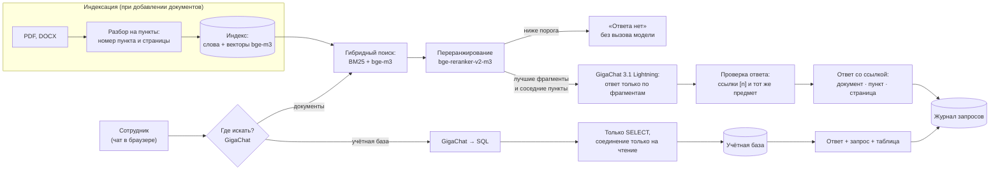

# AI-агент для поиска ответов по внутренней документации и базам данных предприятия

Прототип по задаче индустриального партнёра № 28 (ООО «НПВП «НаноТехноПром») в акселерационной программе «Школа студенческого технологического предпринимательства «Мой стартап» РГРТУ.

Сотрудник задаёт вопрос обычным языком. Агент отвечает **только по внутренним документам и учётной базе**:

- **у каждого ответа есть ссылка** на документ, пункт и страницу; одним кликом открывается страница оригинала, где фрагмент выделен маркером;
- **если ответа нет, агент так и говорит** и подсказывает, где ещё поискать, — не выдумывает;
- **документы и база данных в одном окне:** агент сам решает, где искать, а к базе обращается только на чтение и показывает запрос;
- **работает целиком на компьютере предприятия без интернета** на отечественной открытой модели GigaChat 3.1 Lightning (Сбер, лицензия MIT, обучена без иностранных базовых весов);
- **свой документ подключается прямо в чате:** загрузили PDF или DOCX — через несколько секунд агент отвечает и по нему;
- **качество измеряется** на эталонном наборе вопросов, а не обещается.

## Результаты

Эталонный набор `eval/questions.yaml` — 52 вопроса: 36 с ответом в документах, 8 без ответа в документах (в том числе «трудные» — по теме, но отсутствующие в корпусе) и 8 к учётной базе. Кроме основных вопросов в наборе есть перефразировки, вопросы с опечатками и разговорным вводом. Полная таблица — `eval/results/latest.md`.

| Метрика | Значение |
|---|---|
| Правильные ответы (верные факты и ссылка на верный пункт) | **36 из 36** |
| Неверные ответы, показанные пользователю | **0 из 36** |
| Честные отказы на вопросы, ответа на которые в документах нет | **8 из 8** |
| Ответы по учётной базе | **8 из 8** |
| Время ответа, медиана | **1,0 с** |

| Группа вопросов | Верные ответы | Верные отказы | Учётная база |
|---|---|---|---|
| Основной набор | 16 из 16 | 4 из 4 | 5 из 5 |
| Новые факты | 10 из 10 | 4 из 4 | 3 из 3 |
| Перефразировки | 5 из 5 | — | — |
| Опечатки и разговорный ввод | 5 из 5 | — | — |

**Как честно читать эти цифры.** Набор использовался и для отладки: на нём найдены и исправлены ошибки — подмена предмета в ответе, разбор ссылок вида `[1, 3]`, выбор источника. Примеры в подсказках модели не совпадают с вопросами набора. Независимую оценку дадут новые вопросы тестировщиков и реальные вопросы сотрудников партнёра. Ответы модели немного различаются от прогона к прогону; в трёх последних прогонах по документам и отказам результат был одинаковым, по учётной базе — 7–8 из 8.

Скорость (`scripts/bench_speed.py`, результаты в `eval/results/speed_*.md`):

| Компьютер | Генерация | Ответ на вопрос (медиана) |
|---|---|---|
| ПК с RTX 5070 12 ГБ | 263 токена/с | 0,9 с |
| Тот же ПК, только процессор (Ryzen, 12 потоков) | 20 токенов/с | 7,4 с |

## Как это устроено


Слайд в шаблоне акселератора: `docs/slides/arhitektura.pptx`. Черновик всей презентации первого этапа — `docs/slides/prezentatsiya_chernovik.pptx` (13 слайдов, места для заполнения командой выделены оранжевым `[...]`); обе колоды собираются скриптом `python docs/slides/build_slides.py` из шаблона `docs/slides/shablon.pptx`, цифры берутся из словаря `RESULTS` в начале скрипта. Та же схема в виде диаграммы:



**Модель на документах не обучается.** Документы индексируются, и на каждый вопрос модель получает только найденные фрагменты. Поэтому:
- у ответа всегда есть источник;
- новые документы подключаются пересборкой индекса за минуту, а не переобучением;
- права доступа соблюдаются: фрагменты недоступных роли документов модель просто не видит.

**Четыре уровня защиты от выдумок:**
1. Переранжировщик оценивает, отвечает ли лучший найденный фрагмент на вопрос. Если оценка ниже порога, агент отвечает «данных нет», не вызывая модель.
2. Модель получает только найденные фрагменты и инструкцию отвечать по ним, а при отсутствии ответа вернуть маркер `НЕТ_ДАННЫХ`.
3. Программа проверяет, что каждая ссылка `[n]` указывает на выданный модели фрагмент. Ответ без подтверждённой ссылки не показывается.
4. Если найденное лишь похоже на вопрос («зона сомнения» по оценке переранжировщика), модель отдельно проверяет, что ответ относится к тому же предмету. Так отсекаются подмены вида «гарантия на прибор выдана за гарантию на ремонт» или «срок хранения журнала нарядов выдан за срок хранения журнала входного контроля».

**Модели** (все открытые, работают локально через llama.cpp):

| Назначение | Модель | Лицензия |
|---|---|---|
| Ответы, выбор источника, SQL | [GigaChat 3.1 Lightning](https://huggingface.co/ai-sage/GigaChat3.1-10B-A1.8B-GGUF) (10 млрд параметров, 1,8 млрд активных, q4_K_M, 6,5 ГБ) | MIT |
| Поиск по смыслу | [bge-m3](https://huggingface.co/gpustack/bge-m3-GGUF) (Q8_0) | MIT |
| Переранжирование | [bge-reranker-v2-m3](https://huggingface.co/gpustack/bge-reranker-v2-m3-GGUF) (Q8_0) | Apache 2.0 |

Соответствие перечню важнейших наукоёмких технологий (Указ Президента РФ от 18.06.2024 № 529): сквозная технология № 25 «Технологии искусственного интеллекта в отраслях экономики…» и критическая технология № 13 «Технологии создания доверенного и защищенного системного и прикладного программного обеспечения…».

## Быстрый старт (Windows)

Нужен Python 3.11+ и около 10 ГБ на диске.

```bat
pip install -r requirements.txt
python scripts\setup.py
scripts\start_servers.bat
python scripts\build_index.py
scripts\run_chat.bat
```

`setup.py` скачивает llama.cpp и три модели в несколько потоков с докачкой. На ноутбуке без видеокарты NVIDIA используйте `python scripts\setup.py --cpu` и `scripts\start_servers.bat -Cpu`. Чат откроется в браузере на http://localhost:8501.

Проверка качества и скорости:

```bat
python eval\run_eval.py
python scripts\bench_speed.py
```

Код обращается к моделям через OpenAI-совместимый API (адреса — в `kbagent/config.py` или переменных `KB_LLM_URL`, `KB_EMBED_URL`, `KB_RERANK_URL`). Поэтому вместо llama.cpp можно подключить Ollama или сервер предприятия; проверено с llama.cpp b11371.

## Как подключить свои документы

1. Положите PDF и DOCX в папку внутри `data/raw/`, например `data/raw/partner/`.
2. По желанию добавьте рядом `catalog.yaml` с названиями и группами доступа (пример — `data/raw/internal/catalog.yaml`). Без него названием станет имя файла.
3. Пересоберите индекс: `python scripts\build_index.py`.
4. Добавьте реальные вопросы сотрудников в `eval/questions.yaml` и запустите `python eval\run_eval.py`. Если нужно, подберите порог отказа: `python eval\run_eval.py --threshold 0.05`.

Учётная база в прототипе — демонстрационная SQLite (`scripts/make_demo_db.py`). Чтобы подключить реальную, нужно описание таблиц (`SCHEMA_DESCRIPTION` в `kbagent/database.py`) и учётная запись только на чтение.

## Структура

```
kbagent/            ядро агента
  ingest.py         разбор PDF/DOCX на пункты с номерами пунктов и страниц
  store.py          индекс: BM25 и векторы
  retriever.py      гибридный поиск, переранжирование, соседние пункты
  answer.py         ответ по фрагментам, проверка ссылок и предмета, отказ
  preview.py        страница PDF с выделенным фрагментом
  uploads.py        загрузка документов через чат
  database.py       вопрос → SQL (только чтение) → ответ
  agent.py          выбор источника, журнал запросов
app/                чат на Streamlit
eval/               эталонный набор, скрипт оценки, результаты
scripts/            установка, запуск серверов, сборка индекса, замер скорости
data/raw/external/  открытые документы (источники — data/sources.yaml)
data/raw/internal/  демо-регламенты вымышленного предприятия
data/demo_db/       демо-база учёта
docs/               сценарий демо, запрос партнёру, слайд архитектуры
```

## Корпус документов

- **15 открытых документов:** правила по охране труда при эксплуатации электроустановок (приказ Минтруда № 903н) и при работе с инструментом (№ 835н); ГОСТ Р 2.105-2019; ГОСТ Р 7.0.97-2016; руководства по эксплуатации мультиметров, паяльных станций и осциллографов. Около 700 страниц, источники — `data/sources.yaml`.
- **4 демо-регламента вымышленного предприятия** (входной контроль, отказ оборудования, хранение ЭРИ, средства измерений) и согласованная с ними демо-база учёта. Документы помечены «ДЕМО» и не относятся к реальной организации.

## Ограничения и следующие шаги

- Порог «зоны сомнения» и проверка предмета настроены на нашем наборе; на документах партнёра их нужно перепроверить на его вопросах.
- Сканы без текстового слоя пока не распознаются, нужен модуль OCR.
- У DOCX нет страниц: ссылка указывает пункт и раздел. Автонумерация списков Word пока не восстанавливается.
- Разграничение доступа сделано на уровне ролей приложения; для пилота нужна интеграция с учётными записями предприятия.
- Эталонный набор пока небольшой. Главный следующий шаг — реальные документы и вопросы сотрудников партнёра.
